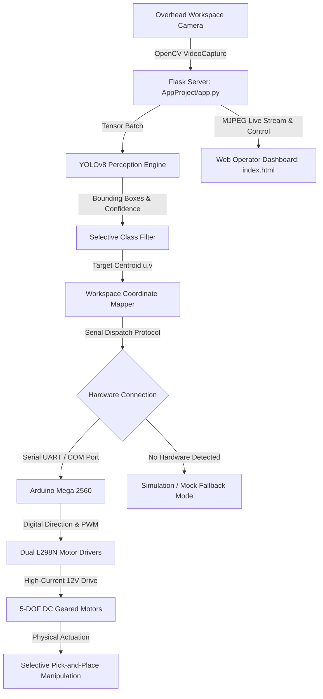

<div align="center">
  
  
  # AI-Based Vision-Controlled Robotic Arm for Selective Object Manipulation
  ByteBastion Engineering Laboratory
  Division: Mecha.exe
  
  <p align="center">
    
    
    
    
    
    
  </p>
  
  <p align="center">
    <a href="https://github.com/TechBastards/AI_Based_Vision_Controlled_Robotic_Arm_For_Selective_Object_Manipulation">
      
    </a>
  </p>
</div>

An intelligent cyber-physical system integrating **real-time computer vision, deep learning perception, and multi-axis embedded motor control** to perform autonomous object detection, spatial localization, and selective pick-and-place manipulation.

---

## 📌 Project Overview

Conventional robotic arms in industrial sorting typically rely on rigid, pre-programmed trajectories and lack real-time visual feedback to adjust to dynamic object placements.

This project bridges **perception (computer vision)** and **action (robotics)** through an end-to-end cyber-physical pipeline:
1. **Visual Perception:** Live video frames captured from an overhead workspace camera are processed using a pre-trained **YOLOv8** model.
2. **Selective Filtering:** Filters detection streams for designated target classes (e.g., bottles, cups, apples) while ignoring ambient background clutter.
3. **Centroid & Spatial Mapping:** Extracts 2D pixel coordinates $(u, v)$ from detection bounding boxes and transforms them into Cartesian workspace coordinates $(x, y)$.
4. **Serial Motor Dispatch:** Dispatches targeted actuation pulse commands over serial UART to an **Arduino Mega 2560**, driving multi-channel **L298N H-bridge motor drivers** to actuate 5 DC geared motors (Base, Shoulder, Elbow, Wrist, Gripper).
5. **Interactive Operator UI:** Hosts a responsive **Flask web console** with live video overlays, manual motor overrides, and automated sorting triggers.

---

## 🗺️ System Architecture



---

## 🛠️ Hardware & Circuit Specifications

| Component | Specification | Function in System |
| :--- | :--- | :--- |
| **Microcontroller** | Arduino Mega 2560 (ATmega2560, 16MHz) | Receives serial actuation characters; drives motor driver logic pins |
| **Motor Drivers** | 2x L298N Dual H-Bridge Modules | Provides isolated high-current bidirectional drive for 5 DC motors |
| **Actuators** | 5x Geared DC Motors (12V, high-torque) | Controls Base Rotation, Shoulder, Elbow, Wrist Pitch, and End-Effector Gripper |
| **Power Supply** | 12V 5A External DC Power Supply | Dedicated motor rail with common ground to Arduino logic |
| **Vision Sensor** | HD USB Webcam (720p/1080p, 30 FPS) | Overhead fixed workspace camera feeding real-time video to host PC |

### Circuit Pinout Configuration

```
Arduino Mega 2560 Pin Mapping:
├── Base Motor:      IN1 -> Pin 2,  IN2 -> Pin 3,  ENA -> Pin 4 (PWM)
├── Shoulder Motor:  IN3 -> Pin 5,  IN4 -> Pin 6,  ENB -> Pin 7 (PWM)
├── Elbow Motor:     IN1 -> Pin 8,  IN2 -> Pin 9,  ENA -> Pin 10 (PWM)
├── Wrist Motor:     IN3 -> Pin 11, IN4 -> Pin 12, ENB -> Pin 13 (PWM)
└── Gripper:         Control Signal -> Pin 22 (Relay / Solenoid / Servo)
```

---

## 📁 Repository Structure

```
AI_Based_Vision_Controlled_Robotic_Arm_For_Selective_Object_Manipulation/
│
├── AppProject/                         # Integrated Production Application
│   ├── app.py                         # Flask server with YOLOv8 & graceful serial fallback
│   └── templates/
│       └── index.html                 # Operator web console with live MJPEG stream
│
├── Documents/
│   └── Images/                        # Circuit schematics, CAD models & blueprints
│       ├── 3D_Model_Creation_on_AutoDesk_Fusion360.png
│       ├── Blue_Print_of_Robotic_Arm.png
│       ├── Object_Detection_using_OpenCV.png
│       ├── Robotic_Arm.png
│       └── Robotic_Arm_Circuit_Diagram.png
│
├── Phase_1_camera_test/               # Phase 1: Camera initialization & FPS benchmark
│   └── CameraTest.py
│
├── Phase_2_yolo_detection/            # Phase 2: Unfiltered YOLOv8 object detection
│   ├── Yolo_Basics.py
│   └── yolov8n.pt                     # Nano model weights
│
├── Phase_3_selective_detection/       # Phase 3: Selective target class filtering
│   └── yolo_selective.py
│
├── Phase_4_coordinate_extraction/     # Phase 4: Bounding box centroid extraction
│   └── yolo_with_coordinates.py
│
├── Phase_5_mapping/                   # Phase 5: 2D Cartesian spatial workspace mapping
│   └── yolo_with_mapping.py
│
├── Robotic_Arm_Arduino_Code/          # Embedded Firmware
│   └── Robotic_Arm_Arduino_Code.ino   # Non-blocking switch-case serial command dispatcher
│
├── requirements.txt                   # Verified Python dependencies
├── .gitignore
└── README.md
```

---

## 🚀 Getting Started

### 1. Prerequisites
* **Python 3.10+** installed
* **Arduino IDE** (for flashing microcontroller firmware)
* USB Webcam connected (Camera index `0` or `1`)

### 2. Clone the Repository
```bash
git clone https://github.com/TechBastards/AI_Based_Vision_Controlled_Robotic_Arm_For_Selective_Object_Manipulation.git
cd AI_Based_Vision_Controlled_Robotic_Arm_For_Selective_Object_Manipulation
```

### 3. Install Python Dependencies
```bash
python -m venv venv
# On Windows:
.\venv\Scripts\activate
# On Linux/macOS:
source venv/bin/activate

pip install -r requirements.txt
```

### 4. Flash Arduino Firmware
1. Connect the Arduino Mega to your PC via USB.
2. Open `Robotic_Arm_Arduino_Code/Robotic_Arm_Arduino_Code.ino` in Arduino IDE.
3. Select **Board: Arduino Mega 2560** and choose your active COM port.
4. Click **Upload**.

### 5. Run the Operator Console
```bash
# Optional: Specify your serial port if different from COM5 (Windows default)
# set SERIAL_PORT=COM3 (Windows Command Prompt)
# $env:SERIAL_PORT="COM3" (PowerShell)
# export SERIAL_PORT=/dev/ttyUSB0 (Linux)

python AppProject/app.py
```
* Navigate to **`http://localhost:5000`** in your browser.
* **Mock / Simulation Mode:** If no physical Arduino is connected, the app automatically enables simulation mode without crashing, allowing full inspection of the YOLOv8 visual detection feed and operator UI!

---

## 🔬 Experimental Development Phases

| Phase | Milestone Script | Focus & Implementation Detail |
| :--- | :--- | :--- |
| **Phase 1** | `Phase_1_camera_test/CameraTest.py` | Validates webcam frame rate, exposure consistency, and resolution buffers. |
| **Phase 2** | `Phase_2_yolo_detection/Yolo_Basics.py` | Benchmarks base inference speed of YOLOv8 nano model on CPU/GPU. |
| **Phase 3** | `Phase_3_selective_detection/yolo_selective.py` | Restricts detection callbacks to user-defined class subsets (e.g., target cups). |
| **Phase 4** | `Phase_4_coordinate_extraction/yolo_with_coordinates.py` | Calculates pixel centroid $(\frac{x_1 + x_2}{2}, \frac{y_1 + y_2}{2})$ and bounding box area. |
| **Phase 5** | `Phase_5_mapping/yolo_with_mapping.py` | Transforms $(u, v)$ pixel space to physical $(X, Y)$ workspace millimeters. |

---

## 📄 License
This project is licensed under the MIT License - see the [LICENSE](LICENSE) file for details.
